<h1 align="center">¡PNCH!</h1>

<p align="center">
  <b>A time clock for your terminal.</b><br>
  Punch in, jot down what you're working on, punch out.<br>
  Every week turns into a work log + invoice PDF, ready to send.
</p>

<p align="center">
  
  
  
  
  <a href="LICENSE"></a>
</p>

<p align="center">
  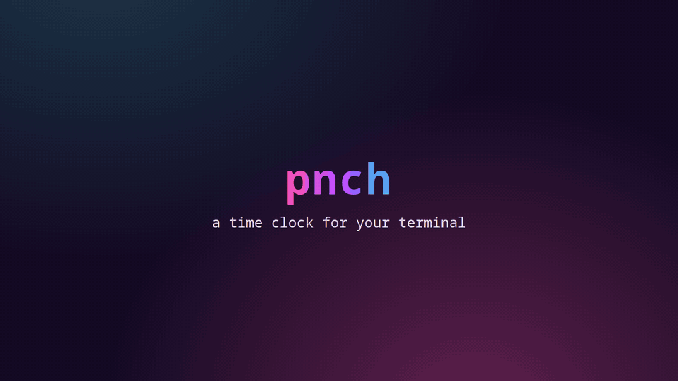
  <br>
  <sub><a href="docs/demo.mp4">Watch the full-quality video</a> · made with fake data</sub>
</p>

<p align="center">
  <a href="#features">Features</a> ·
  <a href="#install">Install</a> ·
  <a href="#quick-start">Quick start</a> ·
  <a href="#using-the-app">Using the app</a> ·
  <a href="#the-pdf">The PDF</a> ·
  <a href="#from-the-shell">From the shell</a> ·
  <a href="#development">Development</a>
</p>

---

## Features

- **Punch in and out in one word.** Type `in`, list what you're doing as you go, type `out`.
- **Weekly log + invoice PDF.** Approve a week, and pnch writes a two-page PDF with your hours, notes and the invoice.
- **Days and weeks at a glance.** Timelines for every day, totals and billed amounts for every week.
- **Fix mistakes easily.** Add a block you forgot, edit times, undo and redo anything.
- **Overlaps handled for you.** If two blocks overlap, merge them, fit one into the gap, shorten or replace the other.
- **Keyboard-only.** `tab` between the prompt bar and the dashboard, arrow keys to move around, `/` for everything else.
- **Never loses your work.** Every `enter` saves. If pnch closes unexpectedly, it picks up where you left off.
- **Six color themes,** including **Leonida**, a neon sunset. Plus Bucky, a boxing beaver who naps while you're off the clock.

<p align="center">
  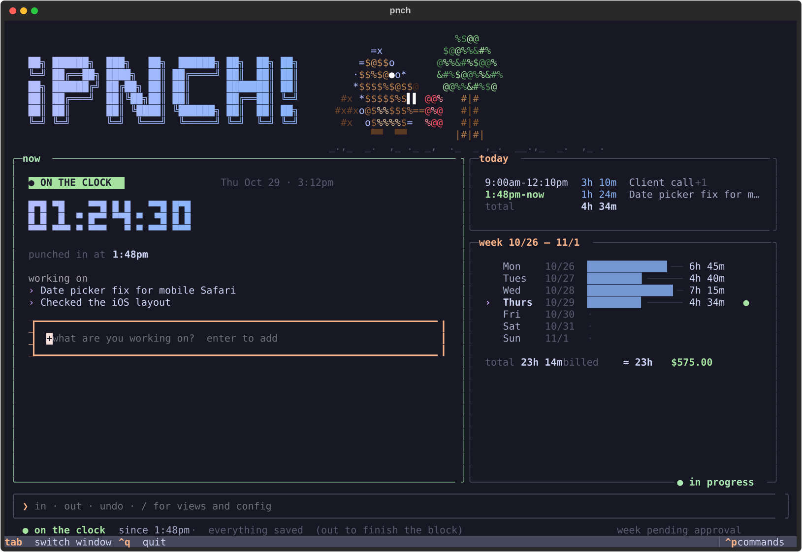
  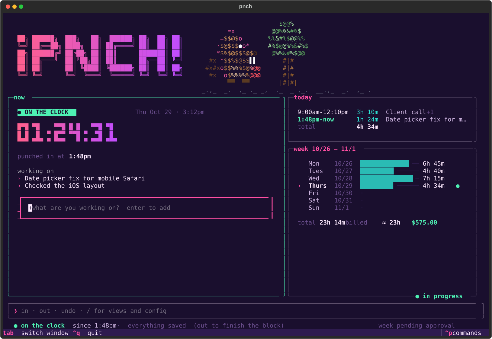
</p>

## Install

Needs **Python 3.11+**.

```sh
git clone https://github.com/ricozama121803/pnch.git
pipx install -e ./pnch
```

<details>
<summary>Optional: the man page</summary>

```sh
mkdir -p ~/.local/share/man/man1 && ln -s "$PWD/pnch/man/pnch.1" ~/.local/share/man/man1/
man pnch
```

</details>

## Quick start

```sh
pnch
```

The first launch walks you through a one-minute setup: your name and email, who you bill,
your hourly rate and a color theme. Then it shows the basic keys. Press `esc` to skip;
you can change everything later with `/config`.

Then:

1. Type **`in`** in the bar at the bottom to start the clock.
2. Type what you're working on in the **working on** box and press `enter`. Add as many items as you like.
3. Type **`out`** when you're done. Add anything you forgot, then press `enter` to save the block.
4. At the end of the week, **`/exportLogs`** approves the week and saves the PDF.

## Using the app

Commands go in the **prompt bar** at the bottom. Typing `/` opens a menu: `↑` `↓` to pick,
`tab` to complete, `enter` to run.

| Command | What it does |
| --- | --- |
| `in` · `in fixing the scraper` | Punch in, optionally with your first item |
| `out` | Punch out: review the block, add anything missing, save |
| `undo` · `redo` | Take back your last change, or put it back |
| `/vday [day]` | View a day's blocks and timeline · `/vday yesterday` |
| `/vweek [week]` | View a week's blocks and timeline · `/vweek last` |
| `/weeks` | Calendar of every week: preview, export or approve any of them |
| `/previewLogs [week]` | Preview the log + invoice PDF |
| `/exportLogs [week]` | Save the PDF to your export folder (approves the week first if needed) |
| `/config` | Hourly rate, color theme, export folder, file names |
| `/help` | Every command and shortcut |

### Keys

| Key | What it does |
| --- | --- |
| `tab` | Switch between the prompt bar and the top section |
| `←` `↑` `→` `↓` | In the top section: move between your items, the working-on box, **today** and **week** |
| `enter` | On a panel: open the day or week view |
| `ctrl+s` | Punch in / punch out |
| `ctrl+n` | Jump to the working-on box |
| `ctrl+z` · `ctrl+y` | Undo · redo |
| `ctrl+p` | Command palette: approve, export, add a past block, … |
| `ctrl+q` | Quit (always asks; on the clock you can punch out or keep it running) |
| `f1` | Every shortcut |

### Punching out

`out` shows the block and what you listed, and asks if you did anything else. Each line is
saved as soon as you press `enter`; an empty `enter` punches out. `esc` keeps you on the clock.

<p align="center">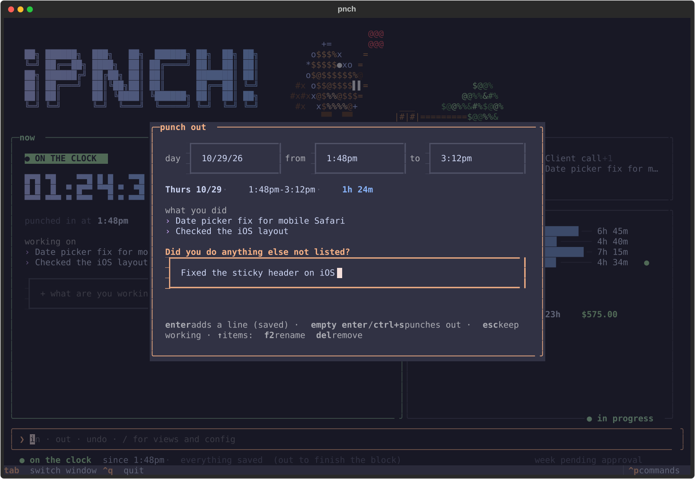</p>

### Days and weeks

Open **today** or **week** from the dashboard (arrow keys, then `enter`), or use `/vday` and
`/vweek`. In a day, `enter` on a block edits it, and the last row, **+ add a block**, adds one.
`[` `]` flip between days or weeks.

<p align="center">
  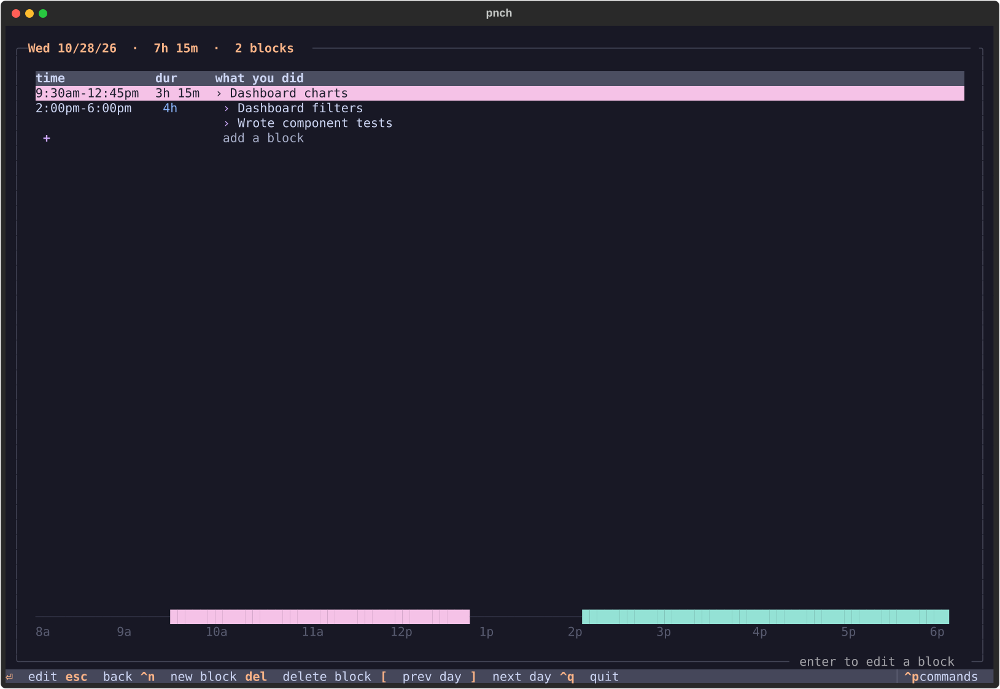
  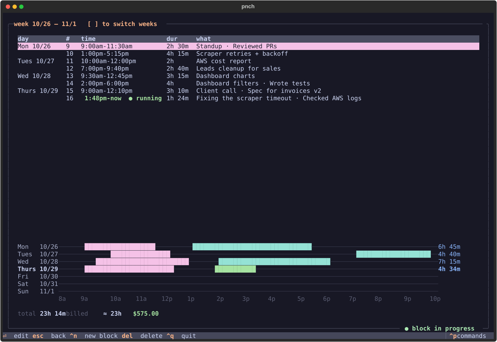
</p>

### Overlapping blocks

If a block's times overlap another one, pnch shows both and offers only the fixes that make
sense: **merge** them, **fit** the new one into the free gap, **shorten** the other one, or
**replace** it.

<p align="center">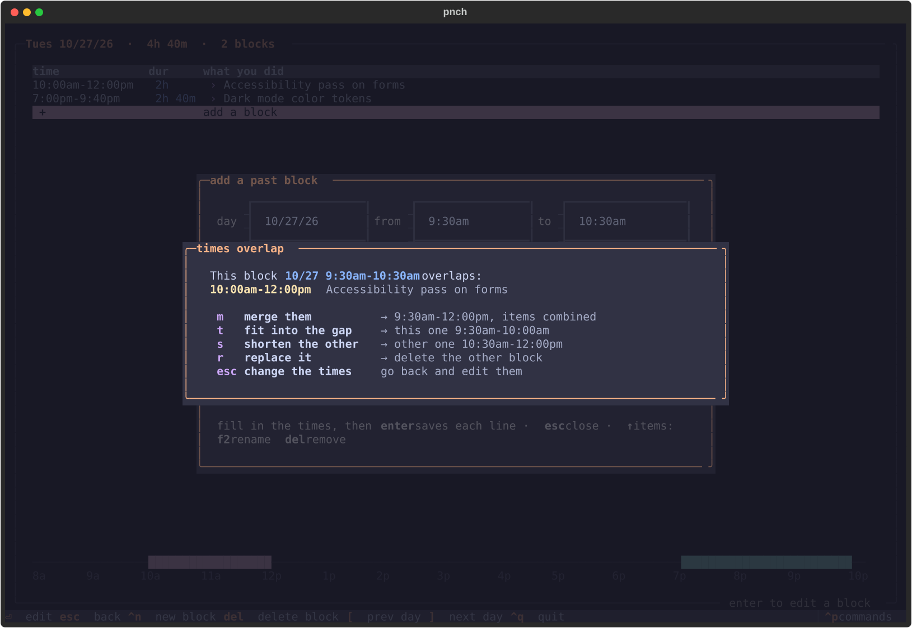</p>

<details>
<summary><b>More screenshots:</b> week picker, slash menu, settings, Bucky asleep</summary>

**`/weeks`**: every week with its hours and status. `↑` `↓` to pick, `p` preview, `e` export, `a` approve.

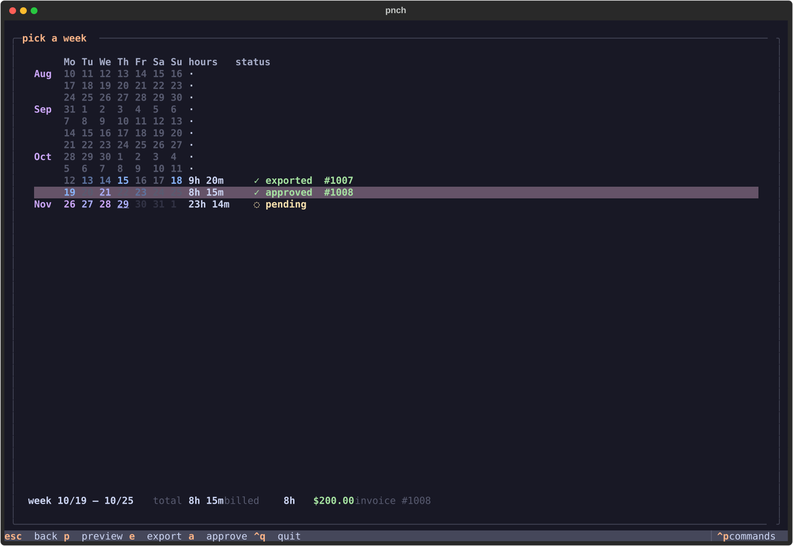

**The slash menu**

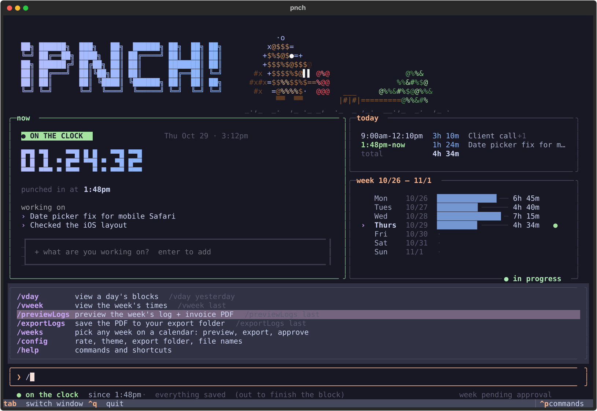

**`/config`**: rate, theme (with live preview), export folder and file-name style.

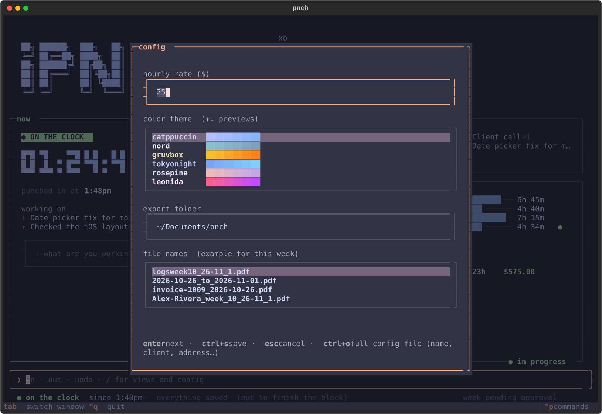

**Off the clock**: Bucky naps until you punch in, then the fight bell wakes him up.

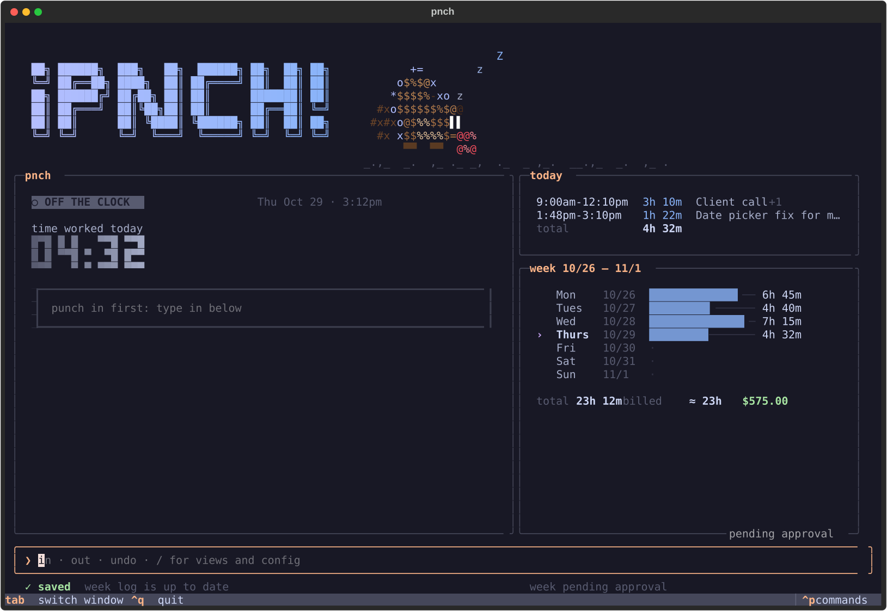

</details>

### Themes

`catppuccin` (default) · `nord` · `gruvbox` · `tokyonight` · `rosepine` · `leonida`

Pick one in the first-run setup or in `/config`. The arrow keys preview each one live.

### Saving and crashes

Everything is written to disk the moment you press `enter`. The status line shows
**● on the clock** while a block is running, **● unsaved** only when you've typed an item but
haven't pressed `enter`, and **✓ saved** otherwise. If pnch closes unexpectedly while you're
clocked in, the next launch tells you when it last saw you and lets you keep the clock running
or end the block then. Half-typed items come back too, and a damaged data file is restored from
its backup.

## The PDF

Approving a week locks it and fixes the billed hours. By default, worked time is rounded down
to whole hours (9h 20m → 9h), and you can change it while approving. The export is two pages:

| Work log | Invoice |
| --- | --- |
| 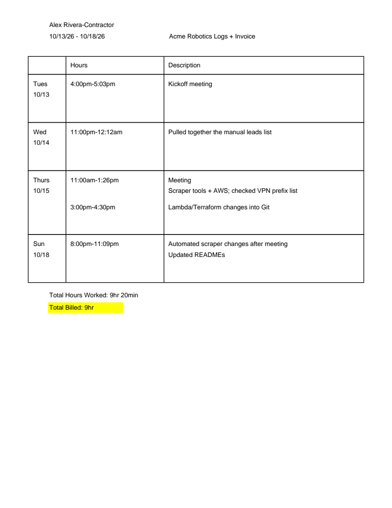 | 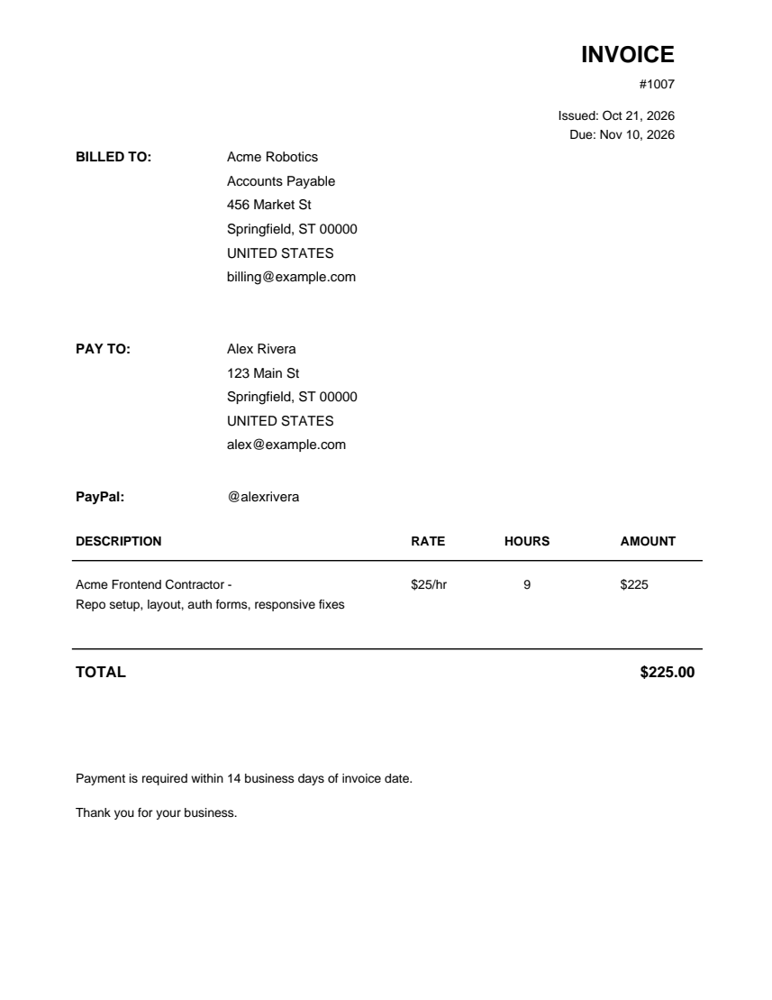 |

Until a week is approved, previews are watermarked **PREVIEW**. Your name, client, addresses,
billing rule and invoice footer live in the config file: `pnch config --edit`.

## From the shell

Every action also works as `pnch <command>`, which is handy for scripts and status bars.

<details>
<summary>Show the commands</summary>

```sh
pnch in fixing the scraper          # clock in (the item is optional)
pnch note "checked VPN prefix list"
pnch out --at 5:15pm                # forgot to clock out
pnch add 10/14 11pm 12:12am pulled the leads list together
pnch log                            # this week's blocks with their #s
pnch edit 3                         # or --start / --end / --note
pnch rm 3
pnch undo                           # pnch redo puts it back

pnch preview -w last                # PDF inline (kitty/Ghostty/WezTerm) or in your viewer
pnch approve -w last                # confirm billed hours + invoice line, lock the week
pnch export -w last                 # write the PDF to your export folder
pnch unapprove -w last              # unlock a week to edit it

pnch weeks                          # hours, invoice # and status per week
pnch status -W                      # live dashboard
pnch bar --json                     # one-liner for waybar / polybar / tmux
```

**Weeks:** `this` · `last` · `-2` · `10/14`
**Days:** `today` · `yesterday` · `tue` · `10/14` · `2026-10-14`
**Times:** `9` · `9am` · `9:30pm` · `930pm` · `21:30`

Weeks run Monday–Sunday, and a block that runs past midnight counts on the day it started.
See `man pnch` for everything.

</details>

## Files

| Path | What's in it |
| --- | --- |
| `~/.config/pnch/config.toml` | Your details, rate, theme, export settings |
| `~/.local/share/pnch/data.json` | The log (plus a `.bak` and undo history) |
| `~/Documents/pnch/` | Exported PDFs (change it in `/config`) |

`pnch config --path` prints them. Set `PNCH_HOME=/some/folder` to keep everything in one place.

## Development

```sh
python -m venv .venv
.venv/bin/pip install -e '.[dev]'
.venv/bin/python -m pytest -q             # 125 tests, each in its own temp folder
.venv/bin/python scripts/screenshots.py   # regenerate the screenshots
```

The tests cover odd times and dates, overlapping blocks, locked weeks, undo/redo, damaged data
files, export file names, multi-page PDFs, first-run setup, and the app itself driven with real
key presses.

<details>
<summary>Re-recording the demo video</summary>

The demo is recorded from the real app with scripted key presses and fake data, then rendered
with headless Chrome (via Playwright) and ffmpeg:

```sh
.venv/bin/python scripts/demo_video.py record /tmp/pnch-demo
python scripts/demo_video.py render /tmp/pnch-demo   # any Python with playwright installed
```

</details>

## License

[MIT](LICENSE) © Enrico Zamarripa
